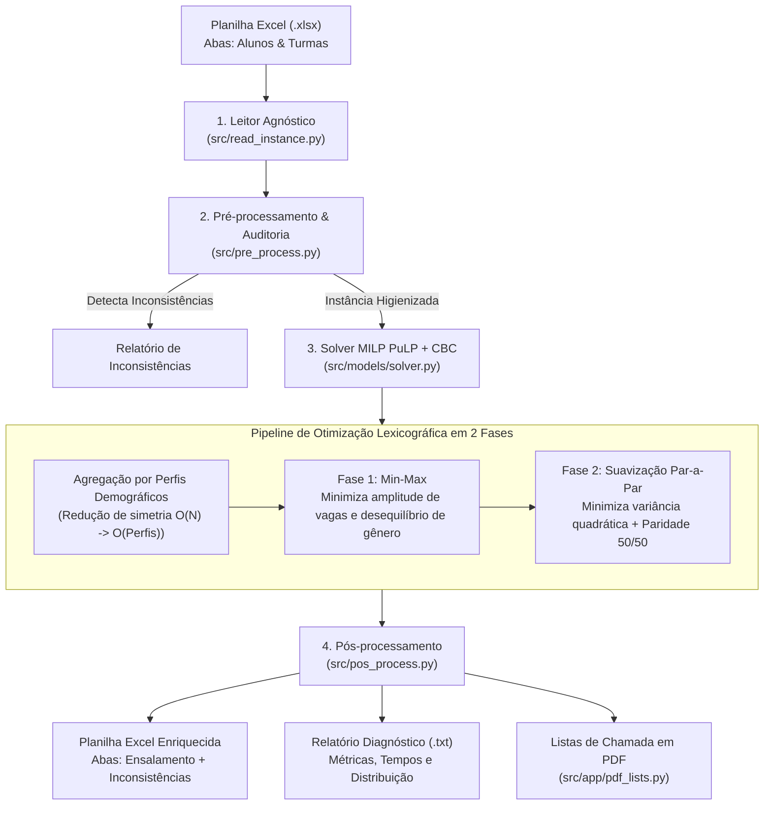

# 🎓 Sistema de Otimização e Gestão de Ensalamento — UniSoma 2026

> **Equipe 10 | Grupo 20 — Desafio UniSoma 2026**  
> *Solução completa para alocação ótima de turmas, equilíbrio demográfico, validação de inconsistências, aplicativo desktop nativo e automação em lote.*


---

## ⚡ Guia Rápido de Execução (Quickstart)

### 1. Instalação das Dependências no Terminal

Requer **Python 3.10 ou superior**. No terminal do seu sistema operacional:

```bash
# Clone ou acesse o diretório do projeto:
cd desafio_unisoma_2026

# Crie e ative um ambiente virtual:
# Linux / macOS:
python3 -m venv .venv
source .venv/bin/activate

# Windows (PowerShell):
python -m venv .venv
.\.venv\Scripts\Activate.ps1

# Atualize o pip e instale todas as dependências:
pip install --upgrade pip
pip install -r requirements.txt
```

---

### 2. Comandos para Rodar no Terminal

#### A) Aplicativo Desktop Gráfico (Interface Completa)
Para abrir o aplicativo nativo de gestão e visualização interativa de planilhas:

```bash
python -m src.app
# ou:
python src/app/__main__.py
```

#### B) Execução em Linha de Comando (CLI — `main.py`)
Para processar instâncias diretamente pelo terminal sem abrir interface gráfica:

```bash
# Executar uma instância específica com relatório completo no terminal:
python src/main.py instances/public/instancia_2.xlsx

# Executar salvando o resultado diretamente na própria planilha (.xlsx):
python src/main.py instances/public/instancia_2.xlsx --in-place

# Executar todas as instâncias públicas com tabela resumo consolidada:
python src/main.py --all --summary-only
```

---

### 3. Comandos para Gerar o Executável Autônomo (.EXE) para Windows

O projeto já inclui o arquivo de especificação [`UniSomaEnsalamento.spec`](UniSomaEnsalamento.spec) configurado para empacotar o interpretador Python, o solver CBC binário, as rotinas de PDF e toda a interface gráfica em um único executável de 64 bits.

```bash
# 1. Com o ambiente virtual ativo, certifique-se de que o PyInstaller está instalado:
pip install pyinstaller

# 2. Execute a compilação:
pyinstaller --noconfirm UniSomaEnsalamento.spec
```

O arquivo executável final será gerado em:
```text
dist/UniSomaEnsalamento.exe
```

> **Características do executável gerado:**
> - **100% Autônomo:** Não requer Python, PuLP ou solvers instalados na máquina de destino.
> - **Sem Terminal:** Abre diretamente em janela nativa (`console=False`), com ícone e visual desktop.
> - **Totalmente Offline:** Não necessita de conexão à internet para funcionar.

---

## 📌 Sumário
1. [Visão Geral e Arquitetura](#-visão-geral-e-arquitetura)
2. [Modelagem Matemática e Solver MILP](#-modelagem-matemática-e-solver-milp)
3. [Execução via Linha de Comando (CLI — `main.py`)](#-execução-via-linha-de-comando-cli--mainpy)
   - [Tabela de Flags e Argumentos](#tabela-de-flags-e-argumentos)
   - [Exemplos Práticos de Uso](#exemplos-práticos-de-uso)
4. [Aplicativo Desktop Gráfico (GUI)](#-aplicativo-desktop-gráfico-gui)
   - [Recursos e Funcionamento da Interface](#recursos-e-funcionamento-da-interface)
   - [Diagrama de Fluxo do Usuário](#diagrama-de-fluxo-do-usuário)
5. [Documentos Oficiais e Manuais](#-documentos-oficiais-e-manuais)
6. [Estrutura do Repositório](#-estrutura-do-repositório)

---

## 🚀 Visão Geral e Arquitetura

O sistema resolve o problema de **Ensalamento Escolar Balanceado** para o Instituto ABC Aprendiz, considerando:
- **Restrições Rígidas (Hard Constraints)**: Respeito estrito à capacidade máxima de cada sala, correspondência de turno (Manhã, Tarde ou flexibilidade Integral) e alocação única por aluno.
- **Detecção e Tratamento de Inconsistências**: Identificação automática de turmas inexistentes na planilha de alunos (R1), incompatibilidade de turno entre aluno e turma (R2), nomes duplicados e campos ausentes.
- **Otimização Multiobjetivo Lexicográfica**: Minimização simultânea da amplitude de ocupação entre salas do mesmo turno e balanceamento equitativo de gênero (50% F / 50% M).



---

## 🧠 Modelagem Matemática e Solver MILP

O grande diferencial do solver é a **Decomposição por Perfis Demográficos Agregados**:  
Em vez de criar dezenas de milhares de variáveis binárias individuais $x_{i,k} \in \{0, 1\}$ (que tornariam o problema intratável para $N \ge 10.000$ alunos), os alunos válidos são agrupados em perfis $p = (\text{gênero}, \text{turno\_disponível})$.

### Fase 1 (Min-Max):
$$\min Z_1 = W_{\text{qtd}} \cdot \Delta_{\text{qtd}} + W_{\text{gen}} \cdot \Delta_{\text{gen}}$$

Onde $\Delta_{\text{qtd}}$ é a diferença entre a maior e a menor turma de um mesmo turno, e $\Delta_{\text{gen}}$ é a amplitude do desvio de gênero.

### Fase 2 (Dispersão Par-a-Par e Paridade 50/50):
Fixa os limites ótimos alcançados na Fase 1 ($Z_1^*$) e minimiza a soma das diferenças absolutas par-a-par entre todas as turmas, adicionando um termo suavizador $\varepsilon$ para atingir a máxima simetria intra-turma:

$$\min Z_2 = \sum_{k < k'} |N_k - N_{k'}| + \sum_{k < k'} |F_k - F_{k'}| + \varepsilon \sum_k |F_k - M_k|$$

Graças a essa modelagem, instâncias com centenas ou milhares de alunos são resolvidas com solução ótima global em **milissegundos** no solver open-source CBC.

---

## ⌨ Execução via Linha de Comando (CLI — `main.py`)

O orquestrador [`src/main.py`](src/main.py) permite resolver desde uma única planilha até lotes de instâncias de forma totalmente automatizada.

```bash
python src/main.py [caminhos_ou_pastas] [flags]
```

### Tabela de Flags e Argumentos

| Flag / Argumento | Tipo / Padrão | Descrição Completa |
| :--- | :--- | :--- |
| `inputs` | Posicional (`*`) | Caminho para um ou mais arquivos `.xlsx`, pastas ou padrões glob (ex.: `instances/public/*.xlsx`). Se omitido e sem `--all`, processa por padrão `instances/public/`. |
| `--all` | Booleano | Processa em lote todas as instâncias públicas contidas em `instances/public/`. |
| `--summary-only` | Booleano | Suprime os relatórios extensos no console e exibe apenas uma tabela resumo consolidada com status, tempos e funções objetivo. |
| `--in-place` | Booleano | Grava as abas geradas (`Ensalamento` e `Inconsistências`) diretamente no próprio arquivo Excel de entrada, sem criar novas cópias. |
| `--output-dir` | Diretório (padrão: `instances/experiments`) | Pasta onde serão salvas as novas planilhas `.xlsx` processadas (quando `--in-place` não for ativado). |
| `--reports-dir` | Diretório (padrão: `reports`) | Pasta onde os relatórios diagnósticos de texto (`*_relatorio.txt`) são salvos. |
| `--allow-integral` | Booleano | Trata a disponibilidade Integral ou Ambos como flexível, permitindo ao solver alocar o aluno na Manhã ou na Tarde para otimizar o equilíbrio das salas. |
| `--allow-unallocated` | Booleano | Ativa a restrição suave de capacidade ($\sum x_{ik} + u_i = 1$). Caso falte vaga global, aloca o máximo possível de alunos e lista os excedentes na lista de espera. |
| `--w-qtd` | Float (padrão: `1.0`) | Peso de penalização para o desequilíbrio na quantidade total de alunos entre turmas ($W_{\text{qtd}}$). |
| `--w-gen` | Float (padrão: `1.0`) | Peso de penalização para o desequilíbrio de gênero entre turmas ($W_{\text{gen}}$). |
| `--epsilon` | Float (padrão: `1e-4`) | Peso de suavização intra-turma para aproximar cada sala da paridade 50% Feminino / 50% Masculino. |
| `--no-phase2` | Booleano | Desativa a Fase 2, parando a otimização imediatamente após encontrar a solução ótima da Fase 1 (Min-Max). |
| `--auto-phase2` | Booleano | Pula a Fase 2 de forma inteligente quando o perfil de turmas da Fase 1 já for matematicamente único. |
| `--legacy-monolithic` | Booleano | Executa o modelo monolítico com variáveis individuais $x_{ik}$ por aluno (para comparação e benchmarks). |
| `--time-limit` | Inteiro (s) (padrão: `60`) | Tempo limite máximo em segundos por fase de otimização do CBC. |
| `--solver-verbose` | Booleano | Imprime no console os logs brutos e iterações de Branch-and-Bound do solver CBC. |

---

### Exemplos Práticos de Uso

#### 1. Resolver uma planilha individual com relatório detalhado:
```bash
python src/main.py instances/public/instancia_1.xlsx
```

#### 2. Resolver salvando o resultado dentro da própria planilha (`--in-place`):
```bash
python src/main.py instances/public/instancia_1.xlsx --in-place
```

#### 3. Permitir flexibilidade de turno para quem marcou "Integral/Ambos":
```bash
python src/main.py instances/public/instancia_2.xlsx --allow-integral
```

#### 4. Rodar todo o lote de instâncias públicas com tabela resumo:
```bash
python src/main.py --all --summary-only
```

---

## 🖥 Aplicativo Desktop Gráfico (GUI)

O aplicativo desktop nativo é construído com arquitetura moderna e 100% offline: **WSGI local (Bottle) + PyWebView (WebView2) + Grid Tabulator reativo**.

### Recursos e Funcionamento da Interface

1. **Visualizador e Editor de Planilhas em Memória:**
   - Abas dinâmicas para navegar entre `Alunos`, `Turmas`, `Inconsistências` e `Ensalamento`.
   - Edição de células *in-place* com clique duplo, persistência de largura de colunas e paginação de alta performance.
   - Histórico de alterações com Desfazer / Refazer ilimitado (`Ctrl+Z` / `Ctrl+Y`).
   - Inserção de linhas e colunas e exclusão de registros via menu de contexto do botão direito.
2. **Auditoria Visual de Inconsistências:**
   - Destaque com cores e severidade (`IMPEDITIVA`, `ALERTA`, `TRATADA`).
   - Erros impeditivos fixados no topo, seguidos de alertas e tratados em ordem das linhas da planilha original.
   - Botão **"Aplicar Todas as Correções"** para padronização automática de grafias e cabeçalhos em 1 clique.
3. **Dashboard Analítico e Cartões de Turmas:**
   - Visualização em duas colunas organizadas por turno (Manhã e Tarde).
   - Barras gráficas proporcionais de meninos (azul), meninas (coral) e vagas livres (cinza).
   - Indicador automático de economia de recursos caso seja viável fechar salas ociosas sem deixar alunos de fora.
4. **Assistente Inteligente Offline (Chatbot):**
   - Responde em linguagem natural a dúvidas sobre número de alunos alocados, ocupação, proporção de gênero e lista de espera.
5. **Emissão de Relatórios Oficiais em PDF:**
   - **Relatório de Turmas:** Listas de chamada por sala formatadas com logo da ABC Aprendiz e seção de lista de espera.
   - **Relatório do Dashboard:** Relatório analítico da distribuição de alunos e salas.

---

## 📄 Documentos Oficiais e Manuais

Os seguintes documentos acompanham a entrega final do projeto:
- **[`Tutorial_Uso_Ferramenta.pdf`](Tutorial_Uso_Ferramenta.pdf):** Manual de uso oficial com tutorial passo a passo em exatamente 2 páginas, com a identidade visual da ABC Aprendiz.
- **[`Equipe10_Modelagem_Inicial_Desafio_Unisoma_2026.pdf`](Equipe10_Modelagem_Inicial_Desafio_Unisoma_2026.pdf):** Relatório técnico detalhado com formulação matemática e justificativas.
- **[`Modelo Conceitual Desafio 2026.pdf`](Modelo%20Conceitual%20Desafio%202026.pdf):** Especificação conceitual do desafio.
- **[`Template_Apresentacao_Equipes_Desafio_UniSoma_2026.pptx`](Template_Apresentacao_Equipes_Desafio_UniSoma_2026.pptx):** Apresentação executiva da equipe.

---

## 📂 Estrutura do Repositório

```text
desafio_unisoma_2026/
│
├── UniSomaEnsalamento.spec       # Arquivo de especificação para compilação do PyInstaller (.exe)
├── requirements.txt               # Dependências centrais do projeto
├── README.md                      # Documentação completa do projeto
├── Tutorial_Uso_Ferramenta.pdf    # Manual e tutorial de uso oficial em PDF (2 páginas)
├── Validador.exe                  # Validador oficial de soluções do desafio
├── Modelo Conceitual Desafio 2026.pdf
├── Equipe10_Modelagem_Inicial_Desafio_Unisoma_2026.pdf
├── Template_Apresentacao_Equipes_Desafio_UniSoma_2026.pptx
│
├── src/                           # Código-fonte principal
│   ├── main.py                    # Ponto de entrada CLI (orquestrador de lote e flags)
│   ├── read_instance.py           # Leitor robusto de planilhas Excel (.xlsx)
│   ├── pre_process.py             # Higienização, detecção de inconsistências e perfis
│   ├── pos_process.py             # Gravação das abas Ensalamento/Inconsistências e relatórios
│   │
│   ├── models/                    # Modelagem matemática
│   │   └── solver.py              # Solver MILP Lexicográfico em 2 Fases (PuLP/CBC)
│   │
│   └── app/                       # Aplicativo Desktop Nativo
│       ├── __main__.py            # Inicializador da aplicação (PyWebView + Bottle)
│       ├── server.py              # Backend do editor, assistente determinístico e solver
│       ├── pdf_lists.py           # Geração de listas de chamada e relatórios em PDF
│       ├── tutorial_pdf.py        # Gerador do PDF do tutorial de uso
│       ├── images/                # Logotipos e recursos visuais institucionais
│       └── static/                # Frontend responsivo HTML5, CSS3 e Tabulator.js
│
└── instances/                     # Conjuntos de dados
    └── public/                    # Instâncias públicas oficiais de teste (.xlsx)
```

---

## 🏆 Créditos

Desenvolvido pela **Equipe 10 / Grupo 20** para o **Desafio UniSoma 2026**.
