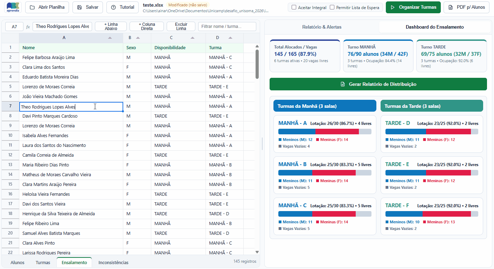

# Aloca ABC — Sistema Inteligente de Ensalamento e Balanceamento de Turmas


## 1º Lugar no Desafio UniSoma 2026 — Equipe 10 (Grupo 20)

**Autores:**

- **Ainaras Marão**
- **Douglas Henrique Ribeiro Almeida Pereira**

Este repositório apresenta o **Aloca ABC**, solução vencedora do **1º Lugar no Desafio UniSoma 2026**, desenvolvido em parceria com a entidade socioassistencial **ABC Aprendiz**.

Construímos uma solução completa de **Pesquisa Operacional e Engenharia de Software** composta por:

1. **Motor Matemático Hierárquico em 2 Estágios (MILP):** Uma reformulação exata em Programação Linear Inteira Mista que elimina a simetria combinatória do problema original e encontra a distribuição globalmente ótima de alunos e gêneros em menos de **1** **segundo**.
2. **Aplicação Desktop Nativa 100% Offline (`Aloca ABC`):** Uma ferramenta visual interativa com editor de planilhas integrado, validação em tempo real, tratamento guiado de inconsistências cadastrais, aviso inteligente de economia de salas ociosas, geração de relatórios oficiais em PDF e Dashboard analítico do ensalamento.

---

## Sumário

1. [O Problema da ABC Aprendiz e Demonstração da Aplicação](#1-o-problema-da-abc-aprendiz-e-demonstração-da-aplicação)
2. [Funcionalidades da Aplicação Aloca ABC](#2-funcionalidades-da-aplicação-aloca-abc)
3. [Arquivos e Documentação do Repositório](#3-arquivos-e-documentação-do-repositório)
4. [Arquitetura e Organização do Código](#4-arquitetura-e-organização-do-código)
5. [Como Baixar, Instalar e Utilizar o Código](#5-como-baixar-instalar-e-utilizar-o-código)
6. [Modelagem Matemática em 2 Estágios](#6-modelagem-matemática-em-2-estágios)
7. [Perguntas Frequentes (FAQ)](#7-perguntas-frequentes-faq)

---

## 1. O Problema da ABC Aprendiz e Demonstração da Aplicação

A **ABC Aprendiz** recebe periodicamente centenas de inscrições de jovens para seus programas de capacitação e aprendizagem profissional. Antes do início das aulas, a equipe pedagógica precisa alocar esses alunos nas turmas dos turnos da **Manhã** e da **Tarde**, respeitando simultaneamente:

- **Capacidades físicas das salas:** Cada turma deve respeitar estritamente o limite máximo de vagas definido para a sala.
- **Disponibilidade de horário declarada pelo jovem:** Alunos inscritos como `Manhã` ou `Tarde` possuem restrição rígida de turno, enquanto alunos inscritos como `Integral` atuam como elo de flexibilidade entre os períodos.
- **Equilíbrio de tamanho entre todas as turmas:** As salas de aula devem ter quantidades de alunos tão próximas quanto possível, tanto dentro de um mesmo turno quanto entre os turnos da Manhã e da Tarde.
- **Equilíbrio demográfico de gênero:** Cada sala deve refletir uma distribuição equilibrada entre alunos do gênero **Masculino (`M`)** e **Feminino (`F`)**, evitando salas desproporcionais e buscando a paridade ideal (50% M / 50% F).
- **Tratamento de dados reais e imperfeitos:** As planilhas de inscrição frequentemente apresentam células em branco, erros de digitação, homônimos (alunos diferentes com o mesmo nome ou inscrições duplicadas), ou excesso/sobra de salas frente à demanda real de inscritos.

Realizar esse planejamento manualmente em planilhas exigia horas de trabalho sujeito a erros humanos e frequentemente resultava em turmas desbalanceadas. O **Aloca ABC** automatiza todo esse fluxo — da auditoria da planilha bruta até a emissão das listas de chamada e relatórios gerenciais em PDF.

### Demonstração do Aloca ABC



---

## 2. Funcionalidades dABC

O **Aloca ABC** foi projetado para ser utilizado diretamente pela equipe administrativa e pedagógica, sem necessidade de conhecimentos em programação ou modelagem matemática:

### 2.1. Abertura de Planilhas, Validação de Cabeçalhos e Botão Salvar

- **Validação Estrutural de Cabeçalhos:** Ao clicar em **Abrir Planilha** e selecionar um arquivo Excel (`.xlsx`), o sistema inspeciona automaticamente se as colunas obrigatórias das abas `Alunos` (`Nome`, `Sexo`, `Disponibilidade`) e `Turmas` (`Turma`, `Vagas`) estão presentes na primeira linha. Caso falte alguma coluna, um alerta orienta exatamente o que ajustar.
- **Botão Salvar (`AlocaABC.xlsx`):** Permite gravar o trabalho em formato Excel a qualquer momento:
  1. **Durante a edição:** Salva as correções de células, padronizações e remoções de duplicatas.
  2. **Após organizar as turmas:** Exporta a planilha completa com as abas originais higienizadas mais a aba **`Ensalamento`** (com a turma atribuída a cada estudante) e a aba **`Inconsistências`** (com o histórico de auditoria e a Lista de Espera).

### 2.2. Validação Reativa e Tratamento de Erros e Homônimos

- **Cards de Erros e Alertas Ordenados por Prioridade:** Na aba **Relatório & Alertas**, o sistema agrupa as pendências por severidade:
  1. **Erros Impeditivos (`[IMPEDITIVA]`):** Células vazias, valores inválidos de sexo/disponibilidade ou alunos `Integral` quando a opção não é aceita. Bloqueiam a otimização até serem corrigidos.
  2. **Alertas de Homônimos / Duplicidade (`[ALERTA]`):** Apontam estudantes com o mesmo nome, oferecendo botões de 1 clique para alternar entre as linhas na tabela, **Mesclar** cadastros repetidos, **Excluir** duplicatas ou **Manter Ambos** caso sejam pessoas distintas.
  3. **Padronizações Automáticas (`[TRATADA]`):** Registram correções automáticas de acentuação e grafia.
- **Navegação em 1 Clique:** Clicar em qualquer card rola a planilha imediatamente até a linha correspondente e destaca a célula em questão.

### 2.3. Controles Operacionais e Aviso Inteligente de Salas Excedentes

- **Chave "Aceitar Integral":** Quando ativada, permite que alunos com disponibilidade `Integral` sejam alocados no turno que melhor equilibre as salas. Quando desativada, o sistema sinaliza imediatamente como erro impeditivo qualquer aluno `Integral` presente na planilha, sem precisar rodar o otimizador.
- **Chave "Permitir Lista de Espera":** Quando o total de inscritos supera a capacidade física das salas, ativar esta opção permite alocar a capacidade máxima viável de estudantes e posicionar o excedente em **Lista de Espera**, priorizando jovens com disponibilidade restrita a um único turno.
- **Mecânica de Aviso sobre Salas a Mais (Economia de Salas Ociosas):**
  - Após distribuir os alunos nas turmas cadastradas na aba `Turmas`, o sistema verifica automaticamente em cada turno se o total de vagas ociosas é maior ou igual à capacidade de uma ou mais salas daquele período.
  - Sempre que detecta que todos os estudantes alocados na Manhã ou na Tarde caberiam em um número menor de salas respeitando o limite de vagas de cada turma, o **Aloca ABC** exibe um aviso no **Dashboard do Ensalamento** e no **Relatório de Distribuição em PDF**, informando quantas salas poderiam deixar de ser usadas naquele turno e qual seria a nova taxa de ocupação.

### 2.4. Editor Estilo Excel, Relatórios em PDF e Dashboard Analítico

- **Editor de Planilha Integrado:** Edição direta com duplo clique ou pela barra de fórmulas (`fx`), botões **`+ Linha Abaixo`**, **`+ Coluna Direita`**, **`Excluir Linha`**, **`Restaurar Ordem`**, atalhos **`Ctrl+Z` / `Ctrl+Y`** e busca/filtro instantâneo por nome ou turma.
- **PDF p/ Alunos:** Gera o PDF pronto para fixação nos murais, contendo uma página por turma com os alunos em ordem alfabética e seção opcional para a Lista de Espera.
- **Dashboard do Ensalamento e Botão "Gerar Relatório de Distribuição":** Painel analítico com KPIs globais, avisos de economia de salas e gráficos de ocupação e proporção Masculino/Feminino por turma. Conta com o botão **Gerar Relatório de Distribuição** fixo no topo do Dashboard para exportar o relatório gerencial completo em PDF.

---

## 3. Arquivos e Documentação do Repositório

Os documentos de apoio, mídias, instâncias públicas de teste e código-fonte estão organizados nas pastas do repositório:

| Arquivo / Diretório                                                                          | Descrição                                                                                                                                                                                                                                                                             |
| :-------------------------------------------------------------------------------------------- | :-------------------------------------------------------------------------------------------------------------------------------------------------------------------------------------------------------------------------------------------------------------------------------------- |
| [`docs/Tutorial_Uso_Ferramenta.pdf`](docs/Tutorial_Uso_Ferramenta.pdf)                       | **Manual e Tutorial de Uso (PDF):** Guia prático completo sobre todas as funcionalidades do **Aloca ABC**, botão Salvar, validação reativa, aviso de salas excedentes e exportação de relatórios (gerado via [`src/app/tutorial_pdf.py`](src/app/tutorial_pdf.py)). |
| [`docs/Modelo Conceitual Desafio 2026.pdf`](<docs/Modelo%20Conceitual%20Desafio%202026.pdf>) | Especificação conceitual oficial do desafio proposta pela UniSoma e ABC Aprendiz.                                                                                                                                                                                                     |
| [`docs/assets/`](docs/assets/)                                                               | Mídias visuais utilizadas na documentação (`equipes_vencedoras.png` e `AnimationF.gif`).                                                                                                                                                                                         |
| [`dist/AlocaABC.exe`](dist/AlocaABC.exe)                                                     | **Executável Standalone para Windows:** Aplicativo compilado pronto para uso imediato no Windows sem necessidade de instalar Python.                                                                                                                                             |
| [`AlocaABC.spec`](AlocaABC.spec)                                                             | Especificação oficial do PyInstaller para compilação do executável `AlocaABC.exe`.                                                                                                                                                                                               |
| [`instances/public/`](instances/public/)                                                     | Planilhas públicas de teste (`instancia_1.xlsx` a `instancia_4.xlsx`) cobrindo diferentes cenários operacionais.                                                                                                                                                                  |
| [`src/models/`](src/models/)                                                                 | Pacote contendo o motor de otimização modularizado em 2 estágios (`solver.py`, `feasibility.py`, `macro_stage.py`, `micro_stage.py`, `types.py`, `legacy_model.py`).                                                                                                     |
| [`src/app/`](src/app/)                                                                       | Pacote da aplicação Desktop e geradores de PDF (`__main__.py`, `server.py`, `pdf_lists.py`, `tutorial_pdf.py` e interface web local).                                                                                                                                         |

---

## 4. Arquitetura e Organização do Código

```text
desafio_unisoma_2026/
├── dist/
│   └── AlocaABC.exe                         # Executavel Windows standalone
├── docs/
│   ├── assets/                              # Imagens e GIFs da documentacao
│   │   ├── AnimationF.gif                   # Demonstracao animada do aplicativo
│   │   └── equipes_vencedoras.png           # Banner oficial das equipes vencedoras
│   ├── Modelo Conceitual Desafio 2026.pdf   # Especificacao conceitual do desafio
│   └── Tutorial_Uso_Ferramenta.pdf          # Manual de uso da aplicacao em PDF
├── instances/
│   └── public/                              # Planilhas de teste (instancia_1.xlsx a instancia_4.xlsx)
├── src/
│   ├── main.py                              # Ponto de entrada via Linha de Comando (CLI)
│   ├── read_instance.py                     # Leitura estrutural das abas do arquivo Excel
│   ├── pre_process.py                       # Higienizacao textual, auditoria e semente SHA-256
│   ├── pos_process.py                       # Escrita das abas Ensalamento e Inconsistencias no Excel
│   ├── models/                              # Motor de Otimizacao Matematica (PuLP / CBC)
│   │   ├── __init__.py                      # Exportacao da API publica do pacote models
│   │   ├── types.py                         # Estruturas de dados (SolverConfig, AllocationResult, Stage1Targets)
│   │   ├── feasibility.py                   # Agregacao nos 6 perfis, analise de capacidade e reducao de salas
│   │   ├── macro_stage.py                   # Estagio 1 (Macro): Particao global entre Manha e Tarde
│   │   ├── micro_stage.py                   # Estagio 2 (Micro): Configuracao das salas por turno e sorteio SHA-256 comparacao
│   │   ├── legacy_model.py                  # Modelo legado original preservado para comparacao
│   │   └── solver.py                        # Orquestrador principal do pipeline de otimizacao
│   └── app/                                 # Aplicacao Desktop GUI (pywebview + Bottle + Tabulator)
│       ├── __main__.py                      # Inicializacao da aplicacao via python -m src.app
│       ├── server.py                        # Servidor local, estado da planilha e rotas de otimizacao/PDF
│       ├── pdf_lists.py                     # Gerador ReportLab (PDF p/ Alunos e Relatorio do Dashboard)
│       ├── tutorial_pdf.py                  # Gerador do arquivo docs/Tutorial_Uso_Ferramenta.pdf
│       └── static/                          # Frontend local (index.html, app.js, styles.css)
├── AlocaABC.spec                            # Especificacao PyInstaller para gerar o AlocaABC.exe
├── requirements.txt                         # Dependencias Python do projeto
└── README.md                                # Documentacao principal do repositorio
```

---

## 5. Como Baixar, Instalar e Utilizar o Código

### 5.1. Opção Rápida (Usuário Final no Windows — Sem Instalar Python)

Se você está em um computador Windows e deseja apenas utilizar a ferramenta gráfica imediatamente:

1. Baixe ou clone este repositório.
2. Acesse a pasta [`dist/`](dist/) e dê um duplo clique em **[`AlocaABC.exe`](dist/AlocaABC.exe)**.
3. O aplicativo abrirá diretamente em uma janela nativa, 100% offline.

---

### 5.2. Instalação a partir do Código-Fonte (Python)

#### Pré-requisitos

- **Sistema Operacional:** Windows 10/11, Linux ou macOS.
- **Python:** Versão `3.10`, `3.11` ou `3.12`.

#### Passo 1: Clonar o repositório

```bash
git clone https://github.com/SEU-USUARIO/desafio_unisoma_2026.git
cd desafio_unisoma_2026
```

#### Passo 2: Criar e ativar o ambiente virtual (`.venv`)

No **Windows (PowerShell)**:

```powershell
python -m venv .venv
.\.venv\Scripts\Activate.ps1
```

No **Linux / macOS**:

```bash
python3 -m venv .venv
source .venv/bin/activate
```

#### Passo 3: Instalar as dependências

```powershell
pip install --upgrade pip
pip install -r requirements.txt
```

---

### 5.3. Executando a Aplicação e Scripts

#### A) Iniciar a Interface Gráfica Desktop (`Aloca ABC`)

```powershell
python -m src.app
```

Para abrir o aplicativo já carregando uma planilha específica:

```powershell
python -m src.app --open instances/public/instancia_1.xlsx
```

Para executar o autodiagnóstico completo do servidor, motor MILP e geradores de PDF:

```powershell
python -m src.app --self-test
```

#### B) Executar via Linha de Comando (CLI) em Lote

O módulo [`src/main.py`](src/main.py) permite processar planilhas `.xlsx` diretamente via terminal:

```powershell
python -m src.main
```

#### C) Regerar o Manual de Uso em PDF (`docs/Tutorial_Uso_Ferramenta.pdf`)

```powershell
python -m src.app.tutorial_pdf
```

#### D) Compilar o Executável Standalone (`dist/AlocaABC.exe`)

Caso realize alterações no código e deseje regerar o executável único para Windows utilizando o arquivo [`AlocaABC.spec`](AlocaABC.spec):

```powershell
pyinstaller --noconfirm --clean AlocaABC.spec
```

---

### 5.4. Bibliotecas e Tecnologias Utilizadas

| Biblioteca / Tecnologia             | Versão Base    | Papel na Arquitetura                                                                                                                              |
| :---------------------------------- | :-------------- | :------------------------------------------------------------------------------------------------------------------------------------------------ |
| **Python**                    | `3.12`        | Linguagem principal do motor matemático e do backend local.                                                                                      |
| **PuLP + Solver COIN-OR CBC** | `2.8.0`       | Modelagem algébrica e resolução exata dos problemas de Programação Linear Inteira Mista (MILP).                                              |
| **OpenPyXL**                  | `3.1.2`       | Leitura e escrita não-destrutiva de planilhas Excel (`.xlsx`).                                                                                 |
| **ReportLab**                 | `4.1.0`       | Renderização vetorial para geração das Listas de Chamada, Relatório do Dashboard e Tutorial de Uso em PDF.                                   |
| **PyWebView**                 | `5.0.5`       | Criação da janela nativa Desktop multiplataforma com integração aos diálogos de arquivos do sistema operacional.                             |
| **Bottle**                    | `0.12.25`     | Micro-framework HTTP embutido (100% local via `127.0.0.1`) que comunica a interface gráfica com o motor Python.                                |
| **Tabulator + Lucide Icons**  | Local / Offline | Componentes de grade editável de alta performance e ícones vetoriais empacotados localmente (zero dependência de internet).                    |
| **PyInstaller**               | `6.5.0`       | Empacotamento do interpretador Python, binários do solver CBC e interface gráfica no executável único `AlocaABC.exe` via `AlocaABC.spec`. |

---

## 6. Modelagem Matemática em 2 Estágios

Abaixo apresentamos em detalhes como modelamos matematicamente o problema de ensalamento.

### 6.1. Por que Decompor em 2 Estágios e Agrupar por Perfis?

Na abordagem clássica de ensalamento (preservada apenas para benchmark em [`src/models/legacy_model.py`](src/models/legacy_model.py)), cria-se uma variável binária $x_{i,k} \in \{0,1\}$ para cada aluno $i \in \{1, \dots, N\}$ e cada turma $k \in \{1, \dots, M\}$, além de variáveis de diferença absoluta $|T_k - T_l|$ para cada par de turmas $(k, l)$.

Essa modelagem sofre de **explosão de simetria combinatória**:

1. Alunos com o mesmo gênero e mesma disponibilidade são matematicamente indistinguíveis para as funções de equilíbrio das turmas; permutá-los gera milhares de soluções com o mesmo valor objetivo.
2. Permutar os índices das $m_s$ salas de um mesmo turno $s$ entre si gera $m_s!$ soluções idênticas na árvore de *Branch-and-Bound*.

Nossa arquitetura resolve ambos os problemas de forma **exata** por meio de três pilares:

1. **Agregação em 6 Perfis Demográficos $p = (g_p, S_p)$:** Agrupamos os alunos por gênero $g_p \in \{\text{M}, \text{F}\}$ e disponibilidade $S_p \in \{\text{Manhã}, \text{Tarde}, \text{Integral}\}$.
2. **Estágio 1 (Macro — Entre Turnos):** Resolve os turnos da `Manhã` e da `Tarde` **conjuntamente** usando **Divisão Euclidiana Linearizada** ($N_s = m_s q_s + r_s$). Como o Teorema do Equilíbrio Inteiro garante que a partição ótima de $N_s$ alunos em $m_s$ salas só utiliza salas de tamanho $\lfloor N_s / m_s \rfloor$ e $\lceil N_s / m_s \rceil$, o Estágio 1 enxerga exatamente os tamanhos individuais de todas as salas sem precisar indexar nenhuma sala individualmente.
3. **Estágio 2 (Micro — Intra-Turno):** Fixados os totais ótimos de homens ($N_{s,\text{M}}^*$) e mulheres ($N_{s,\text{F}}^*$) de cada turno $s$, cada turno resolve um subproblema independente sobre apenas **4 variáveis inteiras** ($t_{00}, t_{10}, t_{01}, t_{11}$) que contam quantas salas recebem os restos da divisão de homens e de mulheres.

---

### 6.2. Conjuntos, Parâmetros e Capacidade Máxima Viável ($U^*$)

- **Turnos:** $\mathcal{S} = \{\text{M}, \text{T}\}$ (representando Manhã e Tarde), com número de salas planejadas $m_s \in \mathbb{Z}_{\ge 0}$ e total de turmas $M = m_{\text{M}} + m_{\text{T}}$.
- **Gêneros:** $\mathcal{G} = \{\text{M}, \text{F}\}$ (Masculino e Feminino).
- **Perfis Demográficos:** $\mathcal{P}$ ($|\mathcal{P}| = 6$), onde $n_p$ é o total de inscritos no perfil $p = (g_p, S_p)$.
- **Capacidade por Sala:** Limite máximo de vagas $C_s$ (ou $C_{\max}$) para cada sala do turno $s \in \mathcal{S}$.

Pela condição de casamento em grafos bipartidos (**Teorema de Hall**), o número máximo de alunos que podem ser fisicamente alocados respeitando as disponibilidades de turno ($n_{\text{M}}$ exclusivos da Manhã, $n_{\text{T}}$ exclusivos da Tarde e $n_{\text{I}}$ do período Integral) e o teto $C_{\max}$ de cada sala é calculado analiticamente em $O(1)$ antes de invocar o solver (em [`src/models/feasibility.py`](src/models/feasibility.py)):

$$
U_{\text{M}}^{\max} = \min\left(n_{\text{M}} + n_{\text{I}}, \; m_{\text{M}} C_{\max}\right)
$$

$$
U_{\text{T}}^{\max} = \min\left(n_{\text{T}} + n_{\text{I}}, \; m_{\text{T}} C_{\max}\right)
$$

$$
U^* = \min\left(n_{\text{M}} + n_{\text{T}} + n_{\text{I}}, \; U_{\text{M}}^{\max} + U_{\text{T}}^{\max}\right)
$$

---

### 6.3. Estágio 1 (Macro): Partição Global entre Turnos via Divisão Euclidiana

Implementado em [`src/models/macro_stage.py`](src/models/macro_stage.py), o Estágio 1 considera **Manhã e Tarde simultaneamente**.

#### Variáveis de Decisão do Estágio 1

- $y_{p, s} \in [0, n_p] \cap \mathbb{Z}$: Alunos do perfil $p \in \mathcal{P}$ enviados ao turno $s \in \mathcal{S}$ (fixado em $0$ se $s \notin S_p$).
- $N_s, N_{s,\text{M}}, N_{s,\text{F}} \in \mathbb{Z}_{\ge 0}$: Total de alunos, total de homens e total de mulheres alocados no turno $s$.
- **Decomposição Euclidiana do Total ($N_s$):**
  - Quociente piso $q_s \in [0, C_{\max}] \cap \mathbb{Z}$, resto $r_s \in [0, m_s - 1] \cap \mathbb{Z}$ e indicador binário de resto não-nulo $d_s \in \{0, 1\}$.
- **Decomposição Euclidiana por Gênero ($N_{s,g}$):**
  - Quociente piso $q_{s,g} \in [0, C_{\max}] \cap \mathbb{Z}$, resto $r_{s,g} \in [0, m_s - 1] \cap \mathbb{Z}$ e indicador binário $d_{s,g} \in \{0, 1\}$.
- **Envelopes Min-Max Globais:**
  - $L_{\text{T}}, U_{\text{T}}$ (menor e maior tamanho de sala em toda a instituição) e $L_g, U_g$ (menor e maior quantidade do gênero $g$ em qualquer sala).

#### Restrições do Estágio 1

**1. Conservação de Fluxo Demográfico e Meta Global $U^*$ (modo padrão sem lista de espera):**

$$
\sum_{s \in S_p} y_{p, s} = n_p \qquad \forall p \in \mathcal{P}
$$

No modo com Lista de Espera, impõe-se $\sum_{s \in S_p} y_{p, s} \le n_p$ e $\sum_{p, s} y_{p, s} = U^*$, priorizando perfis de turno único.

**2. Agregação por Turno e Gênero:**

$$
N_{s,g} = \sum_{p \in \mathcal{P} : g_p = g} y_{p, s}, \qquad N_s = N_{s,\text{M}} + N_{s,\text{F}} \qquad \forall s \in \mathcal{S}, \; g \in \mathcal{G}
$$

**3. Divisão Euclidiana Linearizada (Total e por Gênero):**

$$
N_s = m_s q_s + r_s, \qquad d_s \le r_s \le (m_s - 1) d_s, \qquad q_s + d_s \le C_{\max}
$$

$$
N_{s,g} = m_s q_{s,g} + r_{s,g}, \qquad d_{s,g} \le r_{s,g} \le (m_s - 1) d_{s,g}
$$

Como $d_s = 0 \iff r_s = 0$ e $d_s = 1 \iff r_s \ge 1$, o menor tamanho de turma no turno $s$ é exatamente $q_s$ e o maior tamanho de turma no turno $s$ é exatamente $q_s + d_s$.

**4. Envelopes Globais Entre Turnos:**

$$
L_{\text{T}} \le q_s, \qquad U_{\text{T}} \ge q_s + d_s \qquad \forall s \in \mathcal{S}
$$

$$
L_g \le q_{s,g}, \qquad U_g \ge q_{s,g} + d_{s,g} \qquad \forall s \in \mathcal{S}, \; g \in \mathcal{G}
$$

#### Otimização Lexicográfica em 2 Fases no Estágio 1

**Fase 1 (Equilíbrio Min-Max de Pior Caso Global):**
Minimiza a maior diferença máxima entre quaisquer duas turmas da instituição (em tamanho total e em cada gênero):

$$
\min \; Z_{\text{Macro, 1}} = P_{\text{tam}}(U_{\text{T}} - L_{\text{T}}) + P_{\text{gen}}\left[(U_{\text{M}} - L_{\text{M}}) + (U_{\text{F}} - L_{\text{F}})\right]
$$

Ao final da Fase 1, os valores ótimos das amplitudes globais $W_{\text{T}}^* = U_{\text{T}}^* - L_{\text{T}}^*$, $W_{\text{M}}^*$ e $W_{\text{F}}^*$ são fixados como restrições rígidas.

**Fase 2 (Refinamento Fino Par-a-Par $L_1$ e Paridade 50/50):**
Quando há múltiplas partições que empatam na mesma amplitude máxima de pior caso (por exemplo, $W_{\text{T}}^* = 1$), a Fase 2 escolhe a distribuição internamente mais harmônica. Dentro de um turno $s$, existem $r_s$ turmas de tamanho $q_s + 1$ e $(m_s - r_s)$ turmas de tamanho $q_s$. A soma das diferenças absolutas entre todos os pares de turmas desse turno é exatamente $r_s(m_s - r_s)$. Como $r_s \in \{0, \dots, m_s - 1\}$ é um inteiro pequeno, linearizamos o termo quadrático $r_s(m_s - r_s)$ de forma **exata** por expansão binária $r_s = \sum_{v=1}^{m_s - 1} v \cdot \lambda_{s,v}$ com $\sum_v \lambda_{s,v} \le 1$, somada às diferenças cruzadas entre turnos e ao desempate de paridade 50/50 ($\delta_{s,g} \ge |N_{s,\text{M}} - N_{s,\text{F}}|$ com peso $\epsilon = 10^{-3}$).

---

### 6.4. Estágio 2 (Micro): Subproblema das 4 Configurações de Sala por Turno

Fixados os quantitativos ótimos $N_{s,\text{M}}^*$ e $N_{s,\text{F}}^*$ de cada turno $s \in \mathcal{S}$ pelo Estágio 1, os quocientes e restos intra-turno já são constantes conhecidas:

$$
q_{\text{M}} = \lfloor N_{s,\text{M}}^* / m_s \rfloor, \quad r_{\text{M}} = N_{s,\text{M}}^* \bmod m_s, \qquad q_{\text{F}} = \lfloor N_{s,\text{F}}^* / m_s \rfloor, \quad r_{\text{F}} = N_{s,\text{F}}^* \bmod m_s
$$

Para manter o equilíbrio ótimo de cada gênero dentro do turno $s$, toda sala de aula deve receber $q_{\text{M}} + a$ homens (com $a \in \{0, 1\}$) e $q_{\text{F}} + b$ mulheres (com $b \in \{0, 1\}$). Existem, portanto, apenas **4 configurações canônicas de sala** possíveis:

|             Variável             | Configuração $(a, b)$ |    Homens na Sala    |   Mulheres na Sala   |        Tamanho Total da Sala        |
| :-------------------------------: | :-----------------------: | :------------------: | :------------------: | :---------------------------------: |
| $t_{00} \in \mathbb{Z}_{\ge 0}$ |        $(0, 0)$        |   $q_{\text{M}}$   |   $q_{\text{F}}$   |   $q_{\text{M}} + q_{\text{F}}$   |
| $t_{10} \in \mathbb{Z}_{\ge 0}$ |        $(1, 0)$        | $q_{\text{M}} + 1$ |   $q_{\text{F}}$   | $q_{\text{M}} + q_{\text{F}} + 1$ |
| $t_{01} \in \mathbb{Z}_{\ge 0}$ |        $(0, 1)$        |   $q_{\text{M}}$   | $q_{\text{F}} + 1$ | $q_{\text{M}} + q_{\text{F}} + 1$ |
| $t_{11} \in \mathbb{Z}_{\ge 0}$ |        $(1, 1)$        | $q_{\text{M}} + 1$ | $q_{\text{F}} + 1$ | $q_{\text{M}} + q_{\text{F}} + 2$ |

#### Formulação Completa do Subproblema Micro (para cada turno $s$)

Implementado em [`src/models/micro_stage.py`](src/models/micro_stage.py), o subproblema de cada turno $s$ resolve:

$$
\min \; u_{\text{low}} + u_{\text{high}}
$$

Sujeito a:
- **Total de salas do turno $s$:**

$$
t_{00} + t_{10} + t_{01} + t_{11} = m_s
$$

- **Salas que recebem $+1$ homem e salas que recebem $+1$ mulher:**

$$
t_{10} + t_{11} = r_{\text{M}}, \qquad t_{01} + t_{11} = r_{\text{F}}
$$

- **Ativação dos extremos de tamanho ($u_{\text{low}}, u_{\text{high}} \in \{0, 1\}$):**

$$
t_{00} \le m_s \cdot u_{\text{low}}, \qquad t_{11} \le m_s \cdot u_{\text{high}}
$$

**Interpretação Geométrica:**

- A variável binária $u_{\text{low}} \in \{0,1\}$ vale $1$ se alguma sala ficar com tamanho $q_{\text{M}} + q_{\text{F}}$ ($t_{00} > 0$).
- A variável binária $u_{\text{high}} \in \{0,1\}$ vale $1$ se alguma sala ficar com tamanho $q_{\text{M}} + q_{\text{F}} + 2$ ($t_{11} > 0$).
- Ao minimizar $u_{\text{low}} + u_{\text{high}}$, o modelo impede que $t_{00} > 0$ e $t_{11} > 0$ coexistam:
  - Se $r_{\text{M}} + r_{\text{F}} \le m_s$, o ótimo atinge $u_{\text{high}} = 0 \implies t_{11} = 0$ (os restos de homens e mulheres são colocados em salas disjuntas $t_{10}$ e $t_{01}$, mantendo todas as salas com tamanhos $q_{\text{M}}+q_{\text{F}}$ ou $q_{\text{M}}+q_{\text{F}}+1$).
  - Se $r_{\text{M}} + r_{\text{F}} > m_s$, o ótimo atinge $u_{\text{low}} = 0 \implies t_{00} = 0$ (todas as salas ficam com tamanhos $q_{\text{M}}+q_{\text{F}}+1$ ou $q_{\text{M}}+q_{\text{F}}+2$).
- Assim, a diferença máxima de tamanho dentro do turno nunca chega a $2$, garantindo **amplitude máxima $\le 1$ simultaneamente no total de alunos, nos homens e nas mulheres**.

---

### 6.5. Projeção Nominal Bijetiva Determinística via `SHA-256`

Uma vez determinado quantos alunos de cada perfil demográfico vão para cada sala, a função [`_assign_students_to_classes`](src/models/micro_stage.py) realiza o mapeamento bijetivo em tempo linear $O(N)$:

1. Calcula-se o hash criptográfico **`SHA-256`** do conteúdo bruto da planilha de entrada (em [`src/pre_process.py`](src/pre_process.py)).
2. Inicializa-se um gerador pseudoaleatório isolado (`random.Random(seed_sha256)`) dentro de cada um dos 6 perfis demográficos $p = (g_p, S_p)$.
3. Os alunos de cada perfil são embaralhados de forma **100% imparcial** (sem viés de ordem alfabética ou linha de inscrição) e **100% reprodutível** (a mesma planilha sempre produzirá exatamente a mesma alocação nominal em qualquer computador).

---

## 7. Perguntas Frequentes (FAQ)

### 7.1. Preciso ter internet ou Python instalado para usar o Aloca ABC?

Não. O executável [`dist/AlocaABC.exe`](dist/AlocaABC.exe) já inclui o interpretador Python, o solver de otimização matemática (COIN-OR CBC), o gerador de relatórios em PDF e a interface gráfica completa. Basta dar dois cliques no arquivo em qualquer computador Windows para utilizar a ferramenta de forma **100% offline**.

### 7.2. O que acontece se eu clicar em "Organizar Turmas" duas vezes seguidas na mesma planilha? Os alunos mudam de sala?

Não. A distribuição nominal dos estudantes utiliza uma semente criptográfica (`SHA-256`) calculada diretamente a partir do conjunto de dados da planilha. Isso garante duas propriedades fundamentais ao mesmo tempo:

- **Imparcialidade:** Os alunos são embaralhados sem qualquer viés de ordem alfabética ou de linha na tabela do Excel.
- **Reprodutibilidade:** Enquanto os dados da planilha forem os mesmos, clicar em **Organizar Turmas** sempre produzirá exatamente o mesmo ensalamento em qualquer computador, impedindo que alguém tente rodar o sorteio várias vezes para favorecer uma combinação específica.

### 7.3. Por que alunos com disponibilidade "Integral" aparecem como erro quando a chave "Aceitar Integral" está desmarcada?

Pela regra estrita padrão do cadastro, cada jovem deve indicar especificamente o turno da `Manhã` ou da `Tarde`. Por isso, quando a opção **Aceitar Integral** está desmarcada, o sistema aponta imediatamente qualquer inscrição `Integral` como pendência impeditiva. Caso a coordenação deseje permitir inscrições com disponibilidade `Integral`, basta ativar a chave **Aceitar Integral** na barra superior: o erro desaparece em tempo real e o otimizador passa a alocar esses estudantes no turno que proporcionar o melhor equilíbrio entre as salas.

### 7.4. Se o sistema avisa que "1 ou mais turmas poderiam ser removidas", por que ele mesmo não exclui a sala sozinho?

O motor de otimização respeita todas as salas que a secretaria cadastrou na aba `Turmas` e distribui os jovens da forma mais equilibrada possível entre elas. No entanto, quando o sistema identifica que o total de vagas ociosas em um turno é maior ou igual à capacidade inteira de uma sala (ou seja, todos os alunos daquele turno caberiam nas demais salas sem ultrapassar o limite de vagas), ele exibe um aviso no **Dashboard do Ensalamento** e no **Relatório de Distribuição em PDF**. Assim, a decisão final permanece com a equipe pedagógica: manter todas as salas abertas com turmas menores ou remover a sala excedente na aba `Turmas` para economizar recursos.

### 7.5. A modelagem em 2 estágios (Macro + Micro) perde qualidade em relação ao modelo original indexado por aluno e turma?

Não. A decomposição em 2 estágios é **matematicamente exata** e atinge exatamente o mesmo valor ótimo global da formulação original indexada por aluno e turma ([`src/models/legacy_model.py`](src/models/legacy_model.py)). A diferença é que, ao agrupar alunos idênticos em 6 perfis demográficos e utilizar a Divisão Euclidiana no Estágio 1 e as 4 configurações canônicas no Estágio 2, eliminamos as permutações simétricas que lentificavam a árvore de busca, reduzindo o tempo de resolução para menos de **1 segundo**.

---

## Autores e Reconhecimento

Projeto desenvolvido por **Ainaras Marão** e **Douglas Henrique Ribeiro Almeida Pereira** (**Equipe 10 / Grupo 20**), premiado com o **1º Lugar no Desafio UniSoma 2026** em parceria com a **ABC Aprendiz**.
